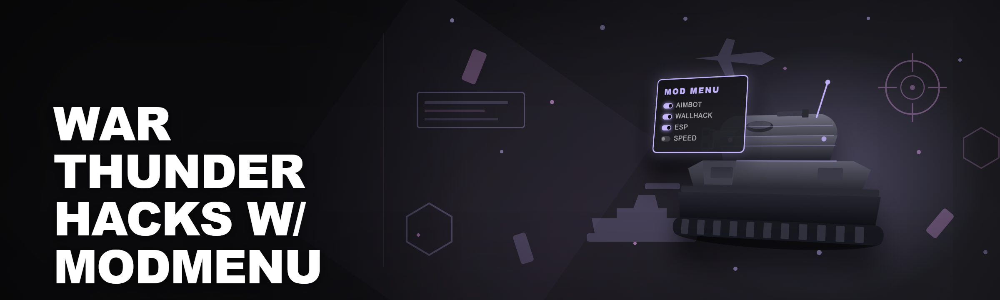
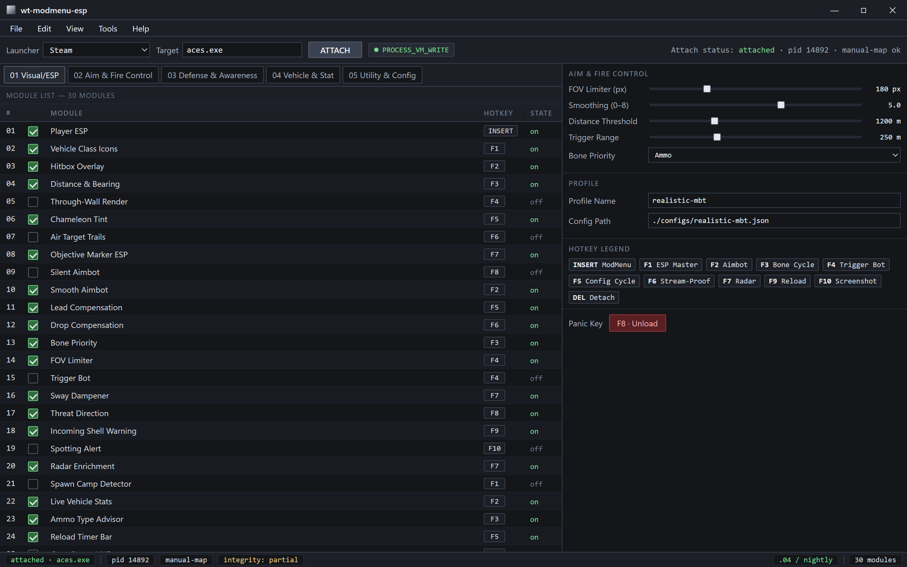
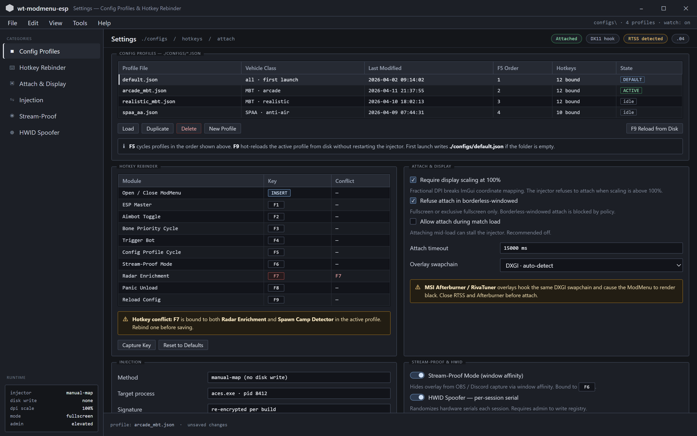
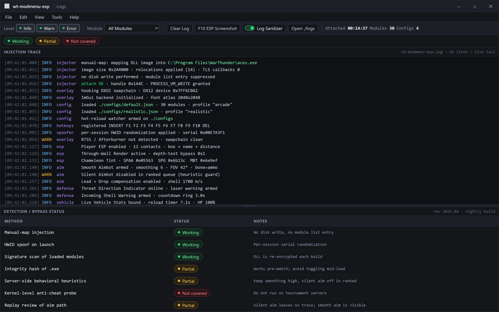

Attach, then toggle — 30 modules, one panel, zero alt-tab.

  
  
  

  

  
  

---

## ⚙️ System Requirements — Read This Before Anything Else

Because the first thing anyone asks in the War Thunder modding Discord is "will this even launch on my rig," here's the honest answer up front. The ModMenu overlay hooks into the DirectX 11/12 render pipeline and reads process memory from `.exe`, so it needs a 64-bit Windows environment with a working GPU driver. No exceptions, no "it sorta works on Wine" — the injector needs native Win32 handle access.

| Component | Minimum | Recommended |
|---|---|---|
| OS | Windows 10 21H2 (64-bit) | Windows 11 23H2+ |
| CPU | Quad-core 3.0 GHz | 6-core 3.8 GHz+ |
| RAM | 8 GB | 16 GB |
| GPU | DX11-capable, 2 GB VRAM | DX12, 6 GB VRAM |
| Storage | 250 MB for the .exe + config | 1 GB (logs, configs, presets) |
| Runtime | .NET Desktop Runtime 8.x | .NET Desktop Runtime 8.x + VC++ 2022 |
| Game | Steam / Gaijin launcher build | Same — attach works on both |

> The .exe will refuse to attach if War Thunder is running under a compatibility flag or in borderless windowed mode with DPI scaling >100%. Set display scaling to 100% and run fullscreen or exclusive fullscreen.

---

## 📖 Overview

`wt-modmenu-esp` is the 2026 rebuild of the War Thunder ModMenu line — a single `.exe` that injects a configurable overlay into the live client, giving you ESP, aim assistance, vehicle stats, shell trajectory readouts, and a hotkey-driven module panel you can toggle mid-match without alt-tabbing. It ships as a self-contained binary: no runtime install wizard, no launcher dependency, no source build step. Extract, run, attach.

| Category | Details |
|---|---|
| Distribution | Standalone `.exe`, portable, no installer |
| Injection | Manual-map DLL injector bundled inside the .exe |
| Overlay | DX11/DX12 hooked ImGui menu, renders over the game |
| Config | JSON profiles in `./configs`, hot-reloadable |
| Supported builds | Steam, Gaijin.net launcher, standalone client |
| Update cadence | Nightly builds, tagged releases weekly |

The whole point of this project is to make module configuration fast. In a game where a match starts 30 seconds after you hit queue, you cannot afford to fumble through a menu. Every module has a default hotkey, every hotkey is rebindable, and every ESP element can be toggled independently so you're not stuck with a wall of boxes obscuring your sight picture.

## 🎯 What This Actually Is

New to the scene? Here's the vocabulary this repo uses, verbatim, so nothing gets lost in translation.

| Term | Explanation |
|---|---|
| ESP | Extra Sensory Perception — draws boxes, names, distance, and vehicle info over enemy targets through geometry |
| Aimbot | Automatic aim adjustment toward a target's hitbox, with configurable FOV, smoothing, and bone priority |
| Wallhack | Rendering enemies through terrain/walls via depth-buffer overrides |
| ModMenu | The in-game overlay panel where you toggle modules and tweak values |
| Injector | The component that loads the cheat DLL into `.exe` memory without touching disk |
| Spoofer | HWID/serial obfuscation layer that masks identifiers from server-side fingerprinting |
| Bypass | Anti-cheat evasion logic (EAC/BattlEye-adjacent checks, integrity scans) |

The benefits, in plain terms:

- You see threats before they see you — vehicle class, distance, and heading on every contact.
- Aim assist compensates for lead and drop without snapping like a bot.
- One panel, one hotkey to open, zero alt-tab.
- Configs save per vehicle class so your arcade setup doesn't leak into realistic battles.
- Updates drop before the game patches break things, usually within 24–48 hours.

## 🧩 Grouped Module Catalog

Thirty modules, grouped by what they actually do in a match. Every one is toggleable from the ModMenu and bindable to a hotkey.

### 👁️ **Visual / ESP Modules**

1. **Player ESP** — 2D box + name + distance over every enemy tank and plane.
2. **Vehicle Class Icons** — small glyph (MBT, SPAA, light, plane) next to the box.
3. **Skeleton / Hitbox Overlay** — draws crew positions and ammo rack locations for shot placement.
4. **Distance & Bearing Readout** — live range and compass bearing to each contact.
5. **Through-Wall Render** — depth-test bypass so contacts stay visible behind cover.
6. **Chameleon Tint** — colors ESP by threat level (SPAA red, SPG orange, MBT white).
7. **Air Target Trails** — projected flight path for aircraft, useful for leading AA fire.
8. **Objective Marker ESP** — capture points and spawn zones highlighted with radius rings.

### 🎯 **Aim & Fire Control Modules**

9. **Silent Aimbot** — adjusts shell trajectory server-side without moving your crosshair on screen.
10. **Smooth Aimbot** — visible aim drift with configurable speed curve, less obvious in replays.
11. **Lead Compensation** — auto-calculates target lead based on velocity and shell speed.
12. **Drop Compensation** — accounts for gravity and shell ballistics at range.
13. **Bone Priority Selector** — choose ammo rack, crew, engine, or breach as the aim target.
14. **FOV Limiter** — restricts aim assist to a configurable cone so it doesn't yank across the map.
15. **Trigger Bot** — fires when crosshair overlaps a valid hitbox within range threshold.
16. **Recoil / Sway Dampener** — reduces the visible weapon sway in gunner view.

### 🛡️ **Defense & Awareness Modules**

17. **Threat Direction Indicator** — arrow showing which direction you're being lazed or spotted from.
18. **Incoming Shell Warning** — highlights incoming projectiles with a countdown ring.
19. **Spotting Alert** — flashes when an enemy scout marks you.
20. **Radar Minimap Enrichment** — overlays hidden contacts onto the minimap.
21. **Spawn Camp Detector** — pings when an enemy sits within X meters of your spawn.

### 🚗 **Vehicle & Stat Modules**

22. **Live Vehicle Stats** — displays reload timer, HP, and module damage for you and (optionally) enemies.
23. **Ammo Type Advisor** — recommends shell type based on target armor profile.
24. **Reload Timer Bar** — visual countdown for your gun and enemy gun (when ESP'd).
25. **Crew Status HUD** — shows which crew members are alive and which modules are damaged.

### 🛠️ **Utility & Config Modules**

26. **Hotkey Rebinder** — remap any module to any key, saved per profile.
27. **Config Profile Switcher** — swap between saved configs with a single keybind.
28. **HWID Spoofer** — masks hardware identifiers between sessions (see bypass table).
29. **Stream-Proof Mode** — hides the overlay from OBS/Discord capture via window affinity.
30. **Log Sanitizer** — wipes injection traces from local log files on exit.

Per-vehicle profiles in ./configs, every hotkey rebindable, attach rules enforced.

  

## 🔐 Detection / Bypass Status

Updated with the 2026.04 anti-cheat revision. This table is maintained by the maintainers and reflects the current nightly build, not a promise.

| Method | Status | Notes |
|---|---|---|
| Manual-map injection | ✅ Working | No disk write, no module list entry |
| HWID spoof on launch | ✅ Working | Per-session serial randomization |
| Signature scan of loaded modules | ✅ Working | DLL is re-encrypted each build |
| Integrity hash of `.exe` | ⚠️ Partial | Works pre-match; avoid toggling mid-load |
| Server-side behavioral heuristics | ⚠️ Partial | Keep smoothing high, silent aim off in ranked |
| Kernel-level anti-cheat probe | ❌ Not covered | Do not run on tournament servers |
| Replay review of aim path | ⚠️ Partial | Silent aim leaves no trace; smooth aim is visible |

Every attach, every signature rebuild — and the bypass table that says what's covered.

## ⌨️ Hotkeys / Controls

Defaults ship with the .exe. Everything is rebindable from the ModMenu.

| Key | Action | Notes |
|---|---|---|
| `INSERT` | Open / close ModMenu | Primary toggle |
| `F1` | Toggle ESP master | All visual modules on/off |
| `F2` | Toggle aimbot | Uses current profile |
| `F3` | Cycle aim target bone | Ammo → Crew → Engine → Breach |
| `F4` | Toggle trigger bot | Off by default |
| `F5` | Cycle config profile | Loads `configs/*.json` in order |
| `F6` | Toggle stream-proof mode | Hides overlay from capture |
| `F7` | Toggle radar enrichment | Minimap contacts |
| `F8` | Panic key | Unloads overlay instantly |
| `F9` | Reload config from disk | Hot-reload without restart |
| `F10` | Screenshot ESP state | Saves to `./logs` for debugging |
| `DEL` | Detach and exit | Clean unload |

## 🧭 The Solution — Problem vs. Fix

| Problem | Solution |
|---|---|
| Alt-tabbing to tweak settings gets you killed in spawn | ModMenu renders over the game; hotkeys toggle modules live |
| Generic ESP overlays all look identical and get flagged | Signature re-encryption per build + stream-proof mode |
| Aim assist snaps like a bot in replays | Silent aim (server-side) or smooth curve with FOV limiter |
| Configs reset after every update | JSON profiles in `./configs`, hot-reloaded with `F9` |
| Anti-cheat catches injection on disk | Manual-map injector, no DLL written to disk |
| HWID bans follow you across accounts | Per-session HWID spoof built into the .exe |
| ESP clutters your sight picture | Per-module toggles + chameleon tint + distance threshold |

## 💡 Tips for Best Results

- Run the .exe **as administrator** — the injector needs `PROCESS_VM_WRITE` on `.exe`.
- Close MSI Afterburner / RivaTuner overlays first; they hook the same DXGI swapchain and cause the ModMenu to render black.
- Start War Thunder first, get to the hangar, then launch the .exe and attach. Attaching during a match load can stall the injector.
- Set display scaling to 100%. Fractional DPI scaling breaks the ImGui coordinate mapping.
- Keep smoothing at 4–8 for smooth aim in realistic battles; 0–2 reads as instant snap in replays.
- Use `F5` profile cycling to keep arcade and realistic configs separate. Reusing one profile across modes is the #1 cause of "it feels wrong" reports.
- If the overlay disappears after a game update, check the nightly build channel — patches almost always need a signature rebuild.

## 🧱 System Requirements (Full)

| Component | Minimum | Recommended |
|---|---|---|
| OS | Windows 10 21H2 64-bit | Windows 11 23H2 64-bit |
| CPU | 4-core / 3.0 GHz | 6-core / 3.8 GHz |
| RAM | 8 GB | 16 GB |
| GPU | DX11, 2 GB VRAM | DX12, 6 GB VRAM |
| Runtime | .NET Desktop 8.x | .NET Desktop 8.x + VC++ 2022 |
| Storage | 250 MB | 1 GB |
| Game client | Steam / Gaijin launcher | Either, latest build |
| Permissions | Admin (for injection) | Admin |

## 🛠️ Installation — Get Started in Three Steps

1. **Grab the build.** Visit the project landing page, hit the download button, and save the `.exe` to a folder you control (not `Program Files`, not the game folder — Windows Defender flags writes into the game directory).
2. **Extract and prep.** If it came as a zip, extract it. Right-click the `.exe` → Properties → check **Unblock** if Windows flagged it (it will — unsigned binary). Set the folder as a Defender exclusion if you don't want to re-unblock every build.
3. **Run and attach.** Launch War Thunder, wait for the hangar. Right-click the `.exe` → Run as administrator. The ModMenu console window opens, shows the attach status, and the in-game overlay appears. Press `INSERT` to open the panel.

> First launch writes a default config to `./configs/default.json`. Copy it, rename it, and tune per vehicle class — that's the intended workflow.

## 🗺️ Roadmap / Planned Features

| Feature | Status | ETA |
|---|---|---|
| Kernel-mode injector variant | 🔬 In research | Q3 2026 |
| Per-vehicle auto-config profiles | 🧪 In testing | Q2 2026 |
| Replay-safe aim path simulator | 📝 Planned | Q4 2026 |
| Linux/Proton attach support | 📝 Planned | Unscheduled |
| Stream-proof 2.0 (GPU-level) | 🧪 In testing | Q2 2026 |
| Weapon-specific ballistic tables | 📝 Planned | Q3 2026 |
| Community config sharing | 📝 Planned | Unscheduled |

## 🐞 Known Issues

| Issue | Fix |
|---|---|
| Overlay renders black when MSI Afterburner is running | Close RTSS / Afterburner before attach |
| `INSERT` does nothing in borderless windowed | Switch to fullscreen or exclusive fullscreen |
| Aim assist yanks on distant targets | Lower FOV limiter to <60px, raise smoothing |
| Attach fails after a game patch | Wait for nightly rebuild; check build channel |
| Config not reloading on `F9` | Ensure no other process holds `./configs` open |
| HWID spoof flagged on first launch each session | Run as admin; spoof needs admin to write registry |

## 📜 Changelog / Release History

| Version | Date | Changes |
|---|---|---|
| 2026.04-nightly | 2026-04-18 | Re-signed DLL after anti-cheat revision; added stream-proof 2.0 bet